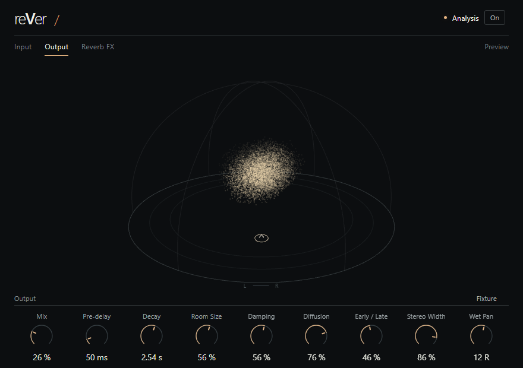

# reVer — A VST3 Reverb with Perceptual Sound-Field Visualization

reVer is an experimental Windows VST3 reverb with Input, Output and Reverb FX spatial views. **The reverb DSP engine is built in Rust and open source.** Acoustic analysis, perceptual mapping, particle rendering and the complete plugin integration remain proprietary.



*Interface preview using authored graphics fixtures. The interface implementation is not included in this repository.*

## Downloads

Early Windows x64 VST3 builds are available under [Releases](../../releases). They are unsigned experimental builds; read the release-specific validation status and known issues before installing. The binary's private portions have separate use terms. Open-source licensing of this engine does not make the complete plugin open source.

## Open engine

This repository contains the actual algorithmic reverb engine used by reVer, its parameter types, DSP tests and a small offline impulse-rendering example. It has no external Rust dependencies and does not include the signal-analysis or visualization implementation.

Controls: Mix, Pre-delay, Decay, Room Size, Damping, Diffusion, Early / Late, Stereo Width and Wet Pan. Construction allocates buffers; processing uses those preallocated buffers. Convolution and Hybrid are reserved mode names and are rejected by this implementation. No compressor is implemented in this engine.

Use Rust 1.99 or newer:

```sh
cargo test --release
cargo run --release --example render_impulse -- impulse.wav
```

The example writes an eight-second, 48 kHz stereo WAV. It is an offline tool; its file I/O does not run in the audio processing path.

```rust
use audio_engine::{AlgorithmicReverb, ReverbParameters};

let mut reverb = AlgorithmicReverb::new(48_000.0).unwrap();
reverb.set_parameters(ReverbParameters {
    mix: 0.25,
    decay_seconds: 2.5,
    ..Default::default()
}).unwrap();
let mut left = [0.0_f32; 256];
let mut right = [0.0_f32; 256];
reverb.process_stereo(&mut left, &mut right).unwrap();
```

Building this crate alone does not produce the complete reVer VST3 plugin. The full product's display interprets acoustic cues; it is not physical room reconstruction or instrument separation. No automatic loudness matching or broad host-compatibility guarantee is provided.

## License

The original engine source, tests and example in this repository use **MPL-2.0**; see [LICENSE](LICENSE). The separately distributed plugin retains the applicable open-source notices and licenses. Private analysis and rendering code are not licensed by this repository. Earlier published versions retain their original license grants; this repository's current scope does not revoke those grants.
